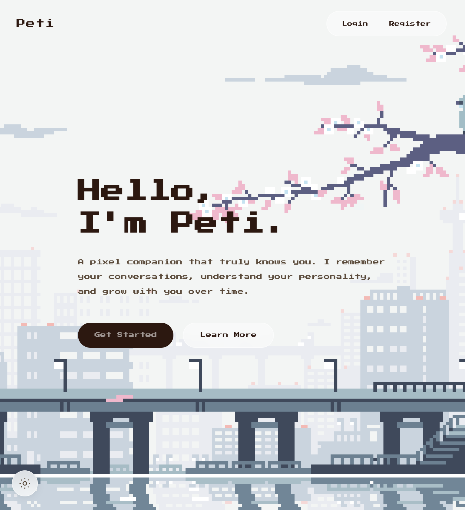
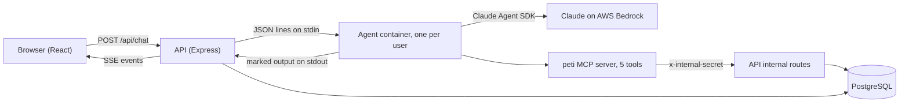

<div align="center">

# Peti

**A pixel companion that truly knows you**

[](LICENSE)
[](client/package.json)
[](client/package.json)
[](api/package.json)
[](https://github.com/nanocoai/nanoclaw)

[What it does](#what-peti-does) · [How it works](#how-it-works) · [Quick start](#quick-start) · [Tests](#tests) · [Layout](#repository-layout) · [Credits](#credits) · [License](#license)



</div>

Peti is a web app with a pixel-art companion that you talk to every day. Most chatbots start from zero each time and know nothing about you. Peti starts with a short game-like personality assessment, written up as your pet getting to know you. It then keeps that profile, a list of memories and a mood, and uses them in every reply.

It is for anyone curious about how a long-lived AI companion can be built: a React front end, an Express and PostgreSQL back end, and one Claude agent per user running in its own Docker container. It began as a spring 2026 course project and the repository still contains the three course write-ups ([PART1.md](PART1.md), [PART2.md](PART2.md), [PART3.md](PART3.md)).

**Status.** Peti was deployed on a single AWS EC2 instance for the course. That deployment is not running now, so there is no live demo. You can run your own copy with the steps below.

## What Peti does

- **Personality assessment.** 106 questions in 6 domains: daily functioning, sleep, emotion regulation, attachment, personality functioning and the Big Five. Answers are saved as you go, so you can leave and resume. Results appear as radar charts with descriptive bands (lower, moderate, higher), not diagnoses.
- **A generated profile.** Once all 6 domains are done, Bedrock models write a profile that the companion reads before every conversation.
- **A companion that remembers.** The agent stores memories in four categories (observation, strategy, preference, milestone) and gets the most important ones back at the start of each session.
- **Mood and state.** Peti has a mood, an energy level and an animation. The agent changes them during a chat and the browser receives the change over the same stream as the reply.
- **A relationship that grows.** The persona files describe four stages (stranger, acquaintance, companion, deep bond). The agent can advance the stage, and the pet's level follows.
- **Five specialist sub-agents.** Health, relationship, hobby, occupational, and growth and purpose. The agent consults them internally when a topic fits and answers in Peti's own voice.
- **Everything else you would expect.** Cookie-based login, user and admin roles, an admin user list, a memories page with search, a category filter and optimistic delete, light and dark themes, a weather panel, and draggable windows.

The pet's appearance is still a placeholder (an emoji on the dashboard). The sprite-swap events are sent by the server, but there is no sprite art in this repository.

### Pages

| Page | Route | Access |
|------|-------|--------|
| Home | `/` | Public |
| Register | `/register` | Public |
| Login | `/login` | Public |
| Pet creation | `/pet/new` | Signed in |
| Personality test | `/test` | Signed in |
| Test results | `/results` | Signed in |
| Profile | `/profile` | Signed in |
| Dashboard (chat, weather, memories) | `/dashboard` | Signed in |
| New memory | `/memories/new` | Signed in |
| Admin dashboard | `/admin` | Admin |
| Admin user detail | `/admin/users/:id` | Admin |

## How it works



**One chat message, step by step**

1. `POST /api/chat` ([`api/src/routes/chat.ts`](api/src/routes/chat.ts)) saves the message, opens a Server-Sent Events stream and delivers any proactive message Peti queued earlier.
2. The container runner ([`api/src/container-runner.ts`](api/src/container-runner.ts)) writes three files for the user: `PROFILE.md` (the generated profile), `STATE.md` (mood, energy, streak) and `CONTEXT.md` (the last 30 messages and the 10 most important memories). It then starts a container named `peti-<userId>` if none is running, with 2 GB of memory, half a CPU, all Linux capabilities dropped and `no-new-privileges`. The user's files are mounted read-write, the character files read-only.
3. AWS credentials and the internal secret reach the container as a JSON line on stdin, not as Docker environment variables. The first line carries the prompt and credentials. Later lines are `{"type":"message","text":"..."}`.
4. Inside the container ([`agent/container/agent-runner/src/index.ts`](agent/container/agent-runner/src/index.ts)) the runner builds the system prompt from the three user files plus [`agent/character/CLAUDE.md`](agent/character/CLAUDE.md) and [`agent/character/RELATIONSHIP_ARC.md`](agent/character/RELATIONSHIP_ARC.md), then calls the Claude Agent SDK through Bedrock. The default model is `us.anthropic.claude-sonnet-4-6`, and `ANTHROPIC_MODEL` overrides it. Two hooks block reads of `.env` and `.db` files and strip AWS keys from shell commands. Text in `<internal>` tags is removed before the reply is sent.
5. The agent can call five tools from the `peti` MCP server ([`peti-mcp.ts`](agent/container/agent-runner/src/peti-mcp.ts)): `pet_update`, `memory_create`, `memory_query`, `profile_update` and `send_message`. Each calls back into `/api/internal/*` ([`internal.ts`](api/src/routes/internal.ts)) with a shared secret, and the API writes to PostgreSQL.
6. The API splits the reply into sentences, streams them to the browser, saves the reply as a message, and reads `STATE.md` back into the `UserState` table when the chat ends.

The container stays up between messages, so the agent keeps its session. The session ID is stored in the `Session` table.

### The companion's brain

The persona is plain Markdown in [`agent/character/`](agent/character), so you can change the character without touching code.

- [`CLAUDE.md`](agent/character/CLAUDE.md) holds the hard rules (for example a 100-word cap per reply and no question stacking), a five-step loop run on every turn, response style, memory rules, three consent tiers for actions (suggest, search with a heads-up, act only with explicit approval) and the instructions for consulting the sub-agents with the SDK's `Task` tool.
- [`RELATIONSHIP_ARC.md`](agent/character/RELATIONSHIP_ARC.md) defines the four stages and how each changes the way Peti behaves, including which sub-agents come into play at which stage.
- [`PROFILE_TEMPLATE.md`](agent/character/PROFILE_TEMPLATE.md) is the blank profile the generator fills in.

The sub-agents are described in the persona prompt and run through the SDK's `Task` tool. They are not separate services or files.

### Generating the profile

[`api/src/profile-generator.ts`](api/src/profile-generator.ts) reads the framework notes in [`docs/framework/`](docs/framework/00-orchestrator.md). It asks Claude Sonnet 4.6 to interpret each of the 6 domains, asks Claude Opus 4.6 to merge them into one profile written like a friend's description of a person, and asks Sonnet 4.6 for a short summary for the profile page. Calls go to Bedrock in `us-west-2`.

### Data model

Eight Prisma models ([`schema.prisma`](api/prisma/schema.prisma)):

```
User ──┬── Pet (one-to-one)
       ├── Memory (one-to-many, soft-delete)
       ├── Message (one-to-many)
       ├── ProfileResult (one-to-many, unique per domain)
       ├── Session (one-to-one)
       ├── UserProfile (one-to-one)
       └── UserState (one-to-one)
```

### API

The REST and SSE endpoints, and the internal routes the agent uses, are listed in [docs/api.md](docs/api.md).

## Quick start

Prerequisites: Node.js 20 or newer, and Docker. The infrastructure scripts install Node 20 and the agent image uses Node 22.

```bash
git clone https://github.com/YuzhengShi/peti-pixel-companion.git
cd peti-pixel-companion

# PostgreSQL
docker compose up -d

# API
cd api
cp .env.example .env       # then set DATABASE_URL, JWT_SECRET and the rest
npm install
npx prisma migrate dev
npm run db:seed            # optional, creates the two test accounts below
npm run dev                # http://localhost:3001

# Client (in a second terminal, from the repository root)
cd client
npm install
npm run dev                # http://localhost:5173
```

The accounts, pages, assessment and memories work with this alone. Chat and profile generation also need the agent image and AWS access:

```bash
docker build -t peti-agent:latest agent/container
```

Then add AWS credentials that can invoke Anthropic models on Amazon Bedrock to `api/.env` (`AWS_ACCESS_KEY_ID`, `AWS_SECRET_ACCESS_KEY`, `AWS_REGION`), or run the API on an EC2 instance with a suitable role. Model access for Claude Sonnet 4.6 and Opus 4.6 must be enabled in your account. Weather needs `OPENWEATHERMAP_API_KEY`.

### Local test accounts

`npm run db:seed` creates these two accounts. They are for local development only.

| Role | Email | Password |
|------|-------|----------|
| Admin | admin@peti.dev | Admin123 |
| User | test@peti.dev | User1234 |

## Tests

```bash
cd client
npm test
```

This runs 33 Vitest tests in 4 files: the scoring engine (18) and the RadarChart, Navbar and MemoriesPage components (5 each). There are no automated tests for the API or the agent.

## Deploying

The scripts in [`infra/`](infra) are what the course deployment used: Terraform ([`main.tf`](infra/main.tf)) for an EC2 instance, plus user-data scripts that install PostgreSQL, Nginx and Docker, build the client and the agent image, and start the API under systemd. Nginx serves the built client and proxies `/api/*` to the API. Copy [`terraform.tfvars.example`](infra/terraform.tfvars.example), fill in your own values, and read the scripts before you run them.

> Before you expose a deployment, change or delete the two seeded accounts. [`infra/user-data.sh`](infra/user-data.sh) tries to run `npx prisma db seed`, which would create them. Also replace the default `JWT_SECRET` and `INTERNAL_SECRET` in your `.env`.

## Repository layout

```
api/                     Express + Prisma back end
  prisma/                schema, migrations, seed script
  src/routes/            auth, chat, internal, memories, messages, pets, profiles, weather, admin
  src/container-runner.ts    starts and talks to the per-user agent containers
  src/profile-manager.ts     writes PROFILE.md, STATE.md, CONTEXT.md; reads STATE.md back
  src/profile-generator.ts   builds the written profile with Bedrock
agent/
  character/             persona, relationship arc, profile template (Markdown)
  container/             Dockerfile and the agent runner with the peti MCP server
client/                  React + Vite front end
  src/questions/         the 106 assessment items
  src/scoring/           scoring, bands and tests
docs/                    API reference and the assessment framework notes
infra/                   Terraform and server setup scripts
PART1.md PART2.md PART3.md   course write-ups
```

## Credits

- **NanoClaw.** The agent container under `agent/container/`, in particular the agent runner, is adapted from [NanoClaw](https://github.com/nanocoai/nanoclaw), which is MIT-licensed. See [NOTICE](NOTICE) for its license text.
- **Claude Agent SDK and Amazon Bedrock** run the agent and the profile generator.
- **Assessment framework.** The assessment follows the Beyond Personality framework, a non-clinical educational framework whose author is credited in [PART1.md](PART1.md). It is described in [docs/beyond-personality-framework.txt](docs/beyond-personality-framework.txt) and [docs/framework/](docs/framework/00-orchestrator.md). The questions are original wording informed by published instruments: the IPIP (Big Five), the ECR-R (attachment), the DSM-5 Alternative Model for Personality Disorders and the LPFS-BF 2.0 (personality functioning), the WHODAS 2.0 (daily functioning), PROMIS Sleep Disturbance (sleep) and the Emotion Regulation Questionnaire (emotion regulation). The instruments belong to their authors and owners. Peti is an educational tool for self-reflection. Its results are not a diagnosis and not a substitute for professional care.
- **Press Start 2P** is loaded from Google Fonts at runtime.

## License

The source code is released under the [MIT License](LICENSE), copyright 2026 Yuzheng Shi.

The MIT license covers the source code only. It does not cover:

- the published instruments named under Credits, which the assessment items and scoring are modelled on;
- the pixel-art animations `client/public/city.gif` and `client/public/city-night.gif`, whose source is not recorded in this repository;
- the music files in `client/public/` (`aventure-lofi-chill-nostalgic-469629.mp3` and `monume-lofi-lofi-girl-lofi-chill-509453.mp3`), whose source is not recorded in this repository;
- the NanoClaw code under `agent/container/`, which stays under its own MIT license (see [NOTICE](NOTICE)).

If you reuse the repository, check the terms of the GIFs and music before you redistribute them.
